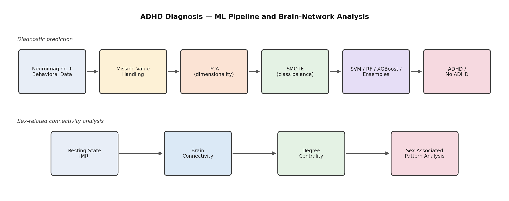

<div align="center">

# ADHD Diagnosis from Neuroimaging and Behavioral Data

**Connectome-based ML classification and a sex-sensitive fMRI network analysis.**
Top 10 globally, WiDS Datathon 2025 🏆


[Overview](#-overview) · [Dataset](#-dataset) · [Workflow](#-workflow) · [Models](#-models) · [Sex analysis](#-sex-sensitive-analysis) · [Structure](#-project-structure)

</div>

<br>

## 🧠 Overview

ADHD diagnosis leans heavily on behavioral and clinical assessment. This project tests whether machine learning can separate ADHD from non-ADHD participants using functional connectome data (brain-region connectivity from neuroimaging) combined with quantitative and categorical metadata, framed as binary classification.

The work has two threads:

- **Diagnostic prediction:** high-dimensional preprocessing, dimensionality reduction, class-imbalance handling, and a comparison of many classifiers.
- **Network analysis:** a degree-centrality analysis of resting-state fMRI from 82 adult patients, examining how ADHD-related connectivity differs between sexes.

|  |  |
|---|---|
| **Task** | Binary classification, ADHD vs. non-ADHD |
| **Inputs** | Functional connectome, quantitative and categorical metadata |
| **Preprocessing** | Missing-value handling, PCA, SMOTE |
| **Metrics** | Recall, F1, ROC-AUC |
| **Libraries** | scikit-learn, XGBoost, LightGBM, imbalanced-learn |

<p align="center">
  
</p>

<br>

## 📂 Dataset

Built on the [WiDS Datathon 2025 data](https://www.kaggle.com/competitions/widsdatathon2025/data):

- Quantitative metadata
- Categorical metadata
- Functional connectome data
- Target labels (ADHD outcome, biological sex)

> [!NOTE]
> Raw and processed data are not included because of their size. Download them from the link above and place them under `data/raw/`.

<br>

## 🔬 Workflow

| Step | Description |
|---|---|
| **1. Data** | Connectome features alongside metadata, so the model is not a pure "MRI to ADHD" classifier. |
| **2. Preprocessing** | Missing-value handling and feature processing to make a messy, high-dimensional dataset usable. |
| **3. PCA** | Compresses many correlated connectivity features into fewer components, reducing redundancy, compute cost, and overfitting risk. |
| **4. SMOTE** | Generates synthetic minority-class samples so classifiers are not biased toward the majority class. |
| **5. Modeling** | Broad classifier comparison. SVM, Random Forest, and XGBoost were among the stronger performers. |
| **6. Network analysis** | Resting-state fMRI treated as a network of regions, with degree centrality compared across sexes. |

<br>

## 🤖 Models

| Family | Models |
|---|---|
| Classical ML | Logistic Regression, SVM, Naive Bayes, KNN, Decision Tree |
| Ensemble and boosting | Random Forest, XGBoost, LightGBM, AdaBoost |
| Combined | Voting ensemble across multiple models |

Many model types were tried on purpose, to see which kind of classifier captures the structure of this data rather than betting on one algorithm.

**Evaluation.** The ADHD labels are imbalanced, so models were judged on Recall, F1, and ROC-AUC instead of raw accuracy, which can mislead on imbalanced classes.

<br>

## 🧪 Sex-sensitive analysis

Beyond predicting ADHD, the project asks whether ADHD-related connectivity differs by sex. Using resting-state fMRI from 82 adult patients, each brain region is a node in a network, and its degree centrality (how strongly it connects to the rest of the network) is compared between groups.

A model that ignores these population differences risks missing meaningful patterns.

<br>

## ⚠️ Scope

This is a research and competition project, not a clinical diagnostic tool. Results reflect the datathon dataset and have not been validated clinically.

<br>

## 🎯 Applications

- Research on neuroimaging-based ADHD classification and feature selection for high-dimensional connectome data
- Studying sex-related differences in brain connectivity to build more population-aware models
- A reference pipeline for imbalanced, high-dimensional biomedical classification (PCA, SMOTE, ensemble comparison)

<br>

## 🧰 Tech stack

Python, scikit-learn, XGBoost, LightGBM, imbalanced-learn, NumPy, Pandas

<br>

## 📁 Project structure

```
.
├── data/
│   ├── raw/                  place downloaded WiDS 2025 files here
│   └── processed/
├── notebooks/
│   └── adhd_diagnosis.ipynb  preprocessing, PCA, SMOTE, model comparison
├── assets/
│   └── pipeline_diagram.png
├── requirements.txt
└── README.md
```
